# YUKTIDOOT: Intelligence that gets work done

**An autonomous AI business assistant for Indian micro-enterprises: interactive frontend prototype.**

> **Status: frontend prototype in demo mode.**
> There is no backend, no database, no AI model and no government-portal integration in this repository.
> Every screen is real and interactive. Backend behaviour is simulated in the browser with structured mock data and
> deterministic rule code. The [What is real, simulated and planned](#what-is-real-simulated-and-planned) table lists exactly which parts are which.

Hackathon problem statement: **PS 3.1, MSME Finance & Compliance.** *"Micro enterprises lose time and profit to compliance paperwork."*

---

## Contents

1. [Problem](#problem)
2. [Core innovation](#core-innovation)
3. [What is real, simulated and planned](#what-is-real-simulated-and-planned)
4. [Quick start](#quick-start)
5. [Demo walkthroughs](#demo-walkthroughs)
6. [Pages](#pages)
7. [Frontend architecture](#frontend-architecture)
8. [Technology stack](#technology-stack)
9. [Mock data and simulation approach](#mock-data-and-simulation-approach)
10. [Environment configuration](#environment-configuration)
11. [Verification performed](#verification-performed)
12. [Screenshots](#screenshots)
13. [Roadmap: backend and AI integration](#roadmap-backend-and-ai-integration)
14. [Known limitations](#known-limitations)

---

## Problem

A micro-enterprise owner (a machining workshop in Pune, a retailer, a small manufacturer) handles compliance paperwork alongside the actual business:

| Pain point | What happens today |
|---|---|
| Fragmented documents | Invoices and receipts are spread across paper, WhatsApp and email |
| Supplier invoice mismatches | A supplier under-reports an invoice in their GST filing, so the buyer's input tax credit (ITC) is at risk, often noticed late |
| Compliance deadlines | GSTR-1, GSTR-3B and TDS dates are tracked from memory or in a notebook |
| Dispatch documentation | Goods are ready, but the e-way bill is incomplete (for example, no vehicle number) |
| Accountant dependency | Every routine question waits for someone else |

## Core innovation

1. **Business understanding first.** The owner can start with a *photo of the workshop*. YUKTIDOOT builds an initial **Business Context Profile** and asks only for what a photo cannot establish: GSTIN, legal name, turnover and suppliers. Every fact records its source (photo-inferred and unconfirmed, owner-confirmed, or learned from documents). A photo never establishes legal or financial facts.
2. **One master agent, a separate Workflow Builder, five specialists.** YUKTIDOOT Core coordinates. The **Workflow Builder** turns each objective plus the business context into a validated execution graph, with branches and human approval checkpoints. The specialists execute: Document & Bookkeeping, Supplier Reconciliation, GST & Compliance, Dispatch & E-way Bill, and an **independent Verification Agent**.
3. **AI for interpretation, rules for numbers.** Tax figures, reconciliation results, GSTIN checks and e-way bill rules come from deterministic code. The Verification Agent recomputes from source data instead of trusting other agents' totals.
4. **Payload-bound human approval.** Anything external, statutory or irreversible waits for the owner. Each approval is bound to a SHA-256 hash of the exact payload. If the payload changes, the old approval is superseded and a fresh, re-verified request is created.

## What is real, simulated and planned

| Area | Implemented (runs in this repo) | Simulated (demo stand-in) | Planned (not in this repo) |
|---|---|---|---|
| UI | All 11 pages, navigation, forms, modals, drawers, filters, charts, uploads, toasts, loading/empty/error states, responsive layout | – | – |
| Workflow Builder | Builds a graph per objective from business context (e.g. composition dealers get no ITC-matching nodes); structural validation (unknown nodes, unregistered handlers, cycles) | – | LLM-assisted planning on Google ADK, still constrained to the tool registry |
| Agent execution | Step executor: runs one registered handler per node, follows branches, pauses at approval nodes, fails safely, logs everything | Agents are local functions, not separate services | Google ADK agents on Cloud Run |
| Document extraction | Upload validation (type, size, empty file); classification by file name | Field values: each upload maps to a sample invoice (by filename keyword, otherwise the next unused sample) | OCR + model extraction via private inference |
| Photo understanding | Wizard, confidence display, owner confirmation, GSTIN checksum validation | Analysis result is fixed (local mock provider) | Vision model via 0G Private Computer |
| "Ask YUKTIDOOT" | Routing to the right page | Intent by keyword matching, labelled as such in the UI | LLM intent interpretation |
| GST arithmetic | CGST/SGST vs IGST by place of supply; totals from line items | – | – |
| GSTIN validation | Format + mod-36 checksum | – | GSTN lookup through a GSP |
| Supplier reconciliation | Rule engine: match by GSTIN + normalised invoice number; ₹1 tolerance; ITC-at-risk | Supplier GST records are mock data shaped like GSTR-2B | GSTR-2B download through a GSP |
| Verification | Independent recomputation: arithmetic, tax type, GSTIN, duplicates, reconciliation re-check, follow-up amount/reference/recipient, e-way bill rules, working-paper rows | – | – |
| Approvals | SHA-256 payload hashing, supersede-on-change, hash re-check at approval time, audit log | – | Server-side signatures / identity |
| Supplier follow-ups | Template draft with rule-engine numbers; edit and re-verify; `mailto:` link and copy | No email is sent | Email/WhatsApp provider |
| Dispatch | Rules: ₹50,000 threshold, Part-B vehicle gate (missing/invalid number blocks), validity 1 day per 200 km, GSTIN/HSN/PIN/distance checks | E-way bill number (`SIM-…`) | NIC e-way bill API |
| GSTR-3B | Working-paper calculation, CSV download, verification, approval | "Submitted" status | Filing through a GSP |
| Persistence | `localStorage` (survives reload; "Reset demo" restores seed data) | – | FastAPI + Firestore / Cloud SQL |
| 0G Private Computer | **None.** The UI states that a local mock provider is active | – | Private inference gateway |
| Google Cloud | **None** | – | Cloud Run, Firestore/Cloud SQL, Storage, Pub/Sub, Cloud Tasks, Firebase Auth, Secret Manager, KMS, Logging |

The in-app **"Demo mode"** pill in the header opens the same breakdown, so evaluators see it while using the app.

## Quick start

Requirements: **Node.js 20.19+ or 22.12+** (Vite 8 requirement) and npm. No accounts, keys or internet access are needed at runtime; fonts are bundled.

```bash
cd yuktidoot-frontend
npm ci            # or: npm install
npm run dev       # development server → http://localhost:5173
```

Production build:

```bash
npm run build     # type-check (tsc -b) + Vite build into dist/
npm run preview   # serve dist/ → http://localhost:4173
```

| Script | What it does |
|---|---|
| `npm run dev` | Vite dev server with HMR |
| `npm run build` | Strict TypeScript check, then production build |
| `npm run preview` | Serve the production build |
| `npm run typecheck` | TypeScript only |
| `npm run screenshots` | Browser walkthrough of both demo scenarios with pass/fail checks; writes `docs/screenshots/` (needs a running `preview` and a local Chrome or Edge; set `CHROME_PATH` if it is not auto-detected) |

**Deploying:** `dist/` is a static single-page app. On any static host, configure a fallback to `index.html` so deep links such as `/dispatch?open=SH-1042` work.

## Demo walkthroughs

The app opens with seed data for *Sharma Precision Works* (a Pune machining unit). Use **Reset demo** (top right) to start over at any time. Demo dates are computed relative to today, so "last month" and deadlines always look current.

### 1. Purchase invoice reconciliation: upload to final approval (≈ 2 minutes)

1. **Invoices → Upload invoice.** Choose the sample **"Shree Ganesh Steel · tax invoice"** (or drop any PDF/JPG whose name contains `ganesh` or `steel`).
2. The invoice drawer opens and the workflow plays live:
   - **Workflow Builder** plans 11 nodes with a *matched / mismatch* branch.
   - **Document Agent** extracts 3 lines (taxable ₹1,01,700, GST ₹18,306, CGST + SGST because the supplier is intra-state) and checks for duplicates.
   - **Reconciliation Agent** finds the supplier's record: taxable ₹78,300, GST ₹14,094. **Mismatch, ITC at risk ₹4,212.** It drafts a supplier follow-up.
   - **Verification Agent** recomputes independently: 8/8 checks, including that the follow-up quotes exactly ₹4,212.
   - The run pauses at **Owner approval**.
3. **Approval Center** shows the exact payload, its SHA-256 hash and the verification result.
4. *(Data-version consistency)* Click **Edit message**, change the text and save. The v1 approval becomes **Superseded**, the draft is re-verified, and a **v2** request appears with a different hash. Removing the invoice number from the message makes verification fail, so no approval is created; the invoice drawer then offers **Edit message** to fix it.
5. **Approve** v2. The workflow resumes and completes. The invoice shows **Follow-up approved**; **Open in email app** pre-fills the message (nothing is sent automatically).
6. *(Optional)* In the invoice drawer, **Simulate supplier correction** (a demo helper) updates the mock GST record. Reconciliation and verification re-run, and the invoice becomes **Resolved** with ₹0 at risk.
7. **Workflow Center** shows the graph with the taken path highlighted and the matched branch marked *not taken*. Click any node to see its agent, approved tool, result and *why the Builder added it*.

Other samples on the same screen:

| Sample | Outcome |
|---|---|
| Patel Packaging | Matches the supplier record; completes with no approval needed |
| Kaveri Lubricants | Not in supplier filings, so the full ₹9,261 ITC is at risk and a follow-up asks the supplier to file |
| Blurry phone photo | Extraction confidence 41% is below the 60% threshold. Fails safely; no fields are guessed |
| Any sample uploaded twice | Blocked as a duplicate; no second book entry |
| A `.txt` file | Rejected at upload with a message |

### 2. Dispatch with a missing vehicle number (≈ 1 minute)

1. **Dispatch & E-way Bill → SH-1042** (Omkar Engineering Works, Kolhapur, ₹2,36,000, 232 km, vehicle number empty).
2. **Validate & prepare e-way bill.** The value is above ₹50,000, so an e-way bill is required. The Part-B check finds no vehicle number, so the shipment is **Blocked: goods must not move**. The run stops at *Block shipment*, and **no approval is requested**.
3. Enter a vehicle number, e.g. `MH09CU4417` (invalid formats are rejected inline), then **Save & validate**. The checks pass: draft prepared, verification 4/4 (validity 2 days for 232 km), and the run pauses for approval.
4. **Approval Center → Approve.** A **simulated** e-way bill number `SIM-…` is generated. Nothing is sent to the NIC portal.
5. Editing the vehicle number while approval is pending supersedes the request and stops the run (payload-bound approval).
6. **SH-1043** (₹38,500) shows the other branch: *e-way bill not required*.

### 3. Other flows worth showing

- **Business Profile → Re-run photo onboarding → Use sample workshop photo.** Visual analysis animation, then inferred fields with confidence, then only the questions a photo can't answer. The GSTIN must pass the checksum.
- **Business Profile → registration type = Composition**, then **Workflow Center → New workflow** to preview the purchase-invoice graph. The ITC-matching nodes disappear, which shows the workflow is generated from context rather than hardcoded.
- **GST & Compliance → Prepare working paper.** GSTR-3B summary (output tax − eligible ITC, with at-risk ITC held back), independent recomputation, CSV download, and approval for a *simulated* submission.
- **Overview → Ask YUKTIDOOT**, e.g. "check my supplier invoices" or "dispatch to Kolhapur". The labelled keyword mock routes you to the right page.
- **Activity Logs**: filter by agent or level, search, and CSV export.

## Pages

| Route | Page | What it shows |
|---|---|---|
| `/` | Overview | Greeting, *Ask YUKTIDOOT* command box, KPIs (approvals, ITC at risk, next deadline, invoices), sales vs purchases chart, reconciliation donut, needs-attention list, live agent status, recent activity |
| `/profile` | Business Profile | Business Context Profile with per-field source and confidence, inline edit/confirm, registration type (changes planning), photo onboarding wizard |
| `/documents` | Documents | Multi-file upload with classification, type/status filters, search, previews (rendered invoice, e-way JSON draft, photo), reclassify, guarded delete |
| `/invoices` | Invoices | Invoice list with filters/search; upload modal with samples; detail drawer with live workflow timeline, extracted fields, document preview, reconciliation table, follow-up, verification checks |
| `/reconciliation` | Supplier Reconciliation | Books vs supplier filing per invoice for a selected period, per-supplier risk, follow-up tracker, re-run |
| `/compliance` | GST & Compliance | GSTR-3B readiness, preparation workflow, working paper + CSV, TDS summary, deadline list computed from today |
| `/dispatch` | Dispatch & E-way Bill | Shipment list, rule explainer, drawer with Part-A/Part-B, inline fixes, rule results, workflow timeline; new-shipment form |
| `/agents` | AI Agents | Agent hierarchy (Builder → Core → 5 specialists) with live status; per-agent drawer: responsibilities, approved tools, recent steps, activity; inference-layer status |
| `/workflows` | Workflow Center | Runs list; interactive execution graph (status colours, animated active edge, auto-scroll to active node); node details incl. Builder rationale; plan summary; *New workflow* with live plan preview |
| `/approvals` | Approval Center | Pending/decided approvals with exact payload, hash, version, verification status; approve/reject with note; edit message (supersede + re-verify) |
| `/activity` | Activity Logs | Full audit trail with filters, search, CSV export |

## Frontend architecture

```
src/
├── App.tsx                 routes (lazy-loaded pages)
├── main.tsx                entry, fonts, styles
├── types/index.ts          domain model = the contract a real backend would return
├── data/                   seed + sample data (parties, sample invoices, agent catalogue, relative dates)
├── lib/                    pure helpers: GST maths & GSTIN checksum, formatting, hashing, CSV, URL params
├── services/               deterministic domain logic (no React)
│   ├── workflowBuilder.ts  objective + context → validated graph
│   ├── reconciliation.ts   books vs supplier filing rule engine
│   ├── verification.ts     independent re-computation checks
│   ├── dispatch.ts         e-way bill / Part-B rules
│   ├── compliance.ts       GSTR-3B working-paper figures
│   ├── followup.ts         supplier follow-up drafting
│   ├── payloads.ts         canonical approval payloads
│   ├── extraction.ts       upload validation, classification, simulated extraction
│   └── inference.ts        InferenceProvider interface + local mock (0G slot)
├── engine/                 local stand-in for agent orchestration
│   ├── engine.ts           graph executor: branches, approval pause/resume, safe failure
│   ├── handlers.ts         approved tool registry (one handler per node type)
│   └── approvals.ts        SHA-256 payload binding, supersede, currency check
├── store/                  state
│   ├── store.ts            external store (immer + useSyncExternalStore), localStorage persistence, reload recovery
│   ├── actions.ts          user commands; the seam where API calls would go
│   ├── seed.ts             initial demo data
│   └── toast.ts            notifications
├── components/
│   ├── ui/                 Button, Card, Badge, Tabs, Field/Input/Select, Modal, Drawer, ConfirmDialog, Dropzone, Toaster, Skeleton, EmptyState
│   ├── domain/             WorkflowGraph, RunTimeline, InvoiceViews, AgentChip, ActivityFeed, status badges, UploadInvoiceModal
│   └── layout/             AppShell (sidebar, header, demo-mode panel), ErrorBoundary, Logo
└── pages/                  the 11 pages
```

**Data flow:** component → `store/actions.ts` → `engine` / `services` → `store.update()` → `useAppState()` re-renders.

Design decisions:

- **External store instead of `useReducer`.** The workflow executor is async and must read the *latest* state between steps; `store.get()` always returns it.
- **`services/` has no React or store imports.** These pure functions are what a backend would port almost unchanged, and the Verification Agent reuses them independently.
- **Approved tool registry.** Graph nodes reference handler names; `validateGraph` rejects any graph that uses an unregistered handler. Nothing is `eval`-ed or generated.
- **Safe failure.** A throwing handler marks the node and run *failed* with the reason, resets the agent and shows a toast. Runs interrupted by a page reload are marked *failed (interrupted)* on load instead of hanging. Each page sits in an error boundary.
- **Deep links.** Drawers and focus targets are URL parameters (`/invoices?open=…`, `/approvals?focus=…`, `/workflows?run=…`), so toasts and lists link straight to the right item.

## Technology stack

| | |
|---|---|
| Framework | React 19 + TypeScript 5.9 (strict, `noUnusedLocals/Parameters`) |
| Build | Vite 8, route-level code splitting |
| Styling | Tailwind CSS 4 (`@theme` tokens) |
| Routing | React Router 7 |
| State | immer + `useSyncExternalStore` |
| Charts | Recharts 3 |
| Icons | lucide-react |
| Fonts | Inter, Fraunces, JetBrains Mono via `@fontsource` (bundled, work offline) |
| Hashing | Web Crypto `SubtleCrypto.digest('SHA-256')` (FNV-1a fallback on non-secure origins, labelled `fnv1a:`) |
| Dev tooling | puppeteer-core (screenshot walkthrough only) |

**Brand palette:** Warm Beige `#EDECE6` (background), Cobalt Blue `#1546D9` (primary), Sun Yellow `#F9B318` (attention/approval), Dark Charcoal `#17171B` (text, sidebar). Muted green and red are used *only* for status semantics (matched / blocked).

## Mock data and simulation approach

- **Business:** Sharma Precision Works, Bhosari MIDC, Pune (state 27), regular GST registrant. GSTINs in the data are fictional but checksum-valid (`makeGstin` computes the check character). Supplier emails use the reserved `.example` domain.
- **Suppliers:** 5 (steel, packaging from Gujarat → IGST, lubricants from Karnataka → IGST, tooling, electricals). **Customers:** 3.
- **History:** 6 processed purchase invoices over the last two months, 2 completed workflow runs, a generated e-way bill (SH-1041), activity entries, 6 months of mock sales/purchase aggregates.
- **Supplier GST records:** shaped like GSTR-2B lines. The Ganesh sample is deliberately under-reported (the EN8 bright-bar line, ₹23,400, is missing); the Kaveri sample is deliberately absent.
- **Extraction simulator** (`services/extraction.ts`): the uploaded file is validated and kept only as metadata. Its *contents are not read*; field values come from the matched sample. Confidence below 60% aborts the workflow without guessing.
- **Inference provider** (`services/inference.ts`): `MockInferenceProvider` returns a fixed photo analysis after a delay and matches intents by keyword. The UI labels both as mock.
- **Timing:** steps are delayed (~0.4–1.3 s) so the multi-agent flow is visible during a demo.

## Environment configuration

None required. Optional (copy `.env.example` to `.env`):

| Variable | Default | Notes |
|---|---|---|
| `VITE_INFERENCE_PROVIDER` | `mock` | Only `mock` is implemented. Any other value (e.g. `0g`) falls back to mock and shows a notice. No 0G client exists in this codebase. |

## Verification performed

On the build in this repository (Windows, Node 24, headless Chrome 1440×900 and 390×844):

- `npm run build`: strict type-check and production build succeed with 0 errors.
- `npm run screenshots`: **30/30 checks passed**, covering:
  - Ganesh extraction (₹1,01,700), the ₹4,212 mismatch, verification passing, the drafted follow-up, the workflow paused at approval, and the matched branch not taken.
  - An edit that drops the invoice number fails verification, so no approval is created. A valid re-edit from the invoice drawer creates a new request with a different hash, and the earlier request is superseded.
  - Approving resumes the run to completion with status *follow-up approved*; the simulated correction then resolves the discrepancy.
  - Patel matches; Kaveri flags full ITC at risk (₹9,261); the blurry photo fails with no fields; a duplicate is blocked; a `.txt` upload is rejected.
  - SH-1042 is blocked on a missing vehicle number, the run stops, and no approval is requested. Adding a valid vehicle requests approval. Changing the vehicle while approval is pending supersedes the request and stops that run. Approving generates a `SIM-` number. SH-1043 is marked *not required*.
  - The GSTR-3B paper is prepared and verified; the Workflow Builder plans 5 nodes for a composition dealer vs 11 for a regular registrant; the not-found route works.
  - No horizontal overflow at 390 px on all 11 pages; no uncaught page errors.

## Screenshots

Captured by `npm run screenshots` from the running app.

| | |
|---|---|
| 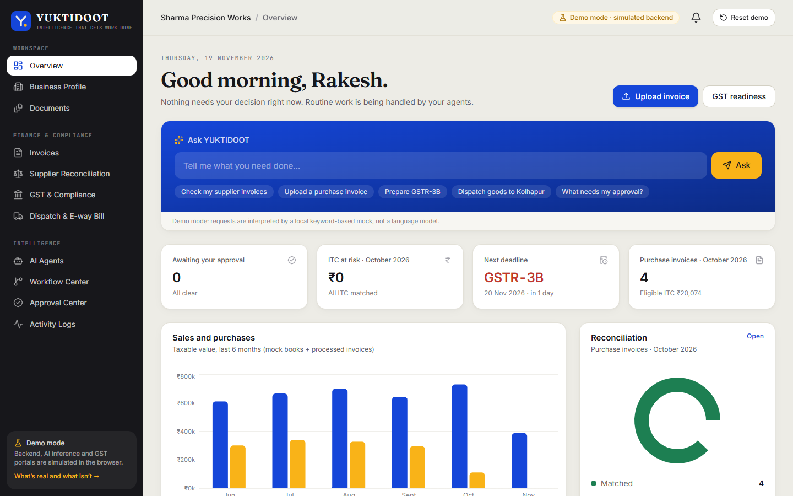 Overview | 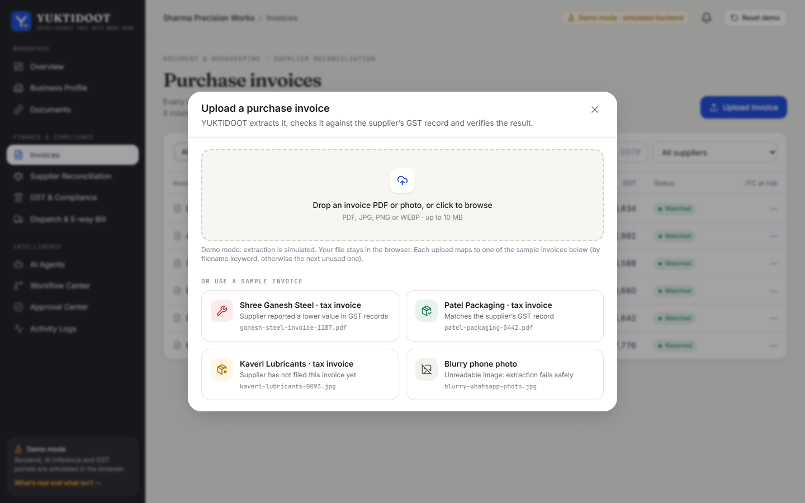 Upload with samples |
|  Invoice workflow paused for approval |  Workflow graph |
|  Payload-bound approval | 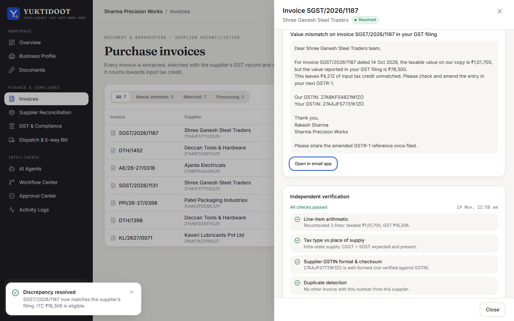 Resolved after supplier correction |
| 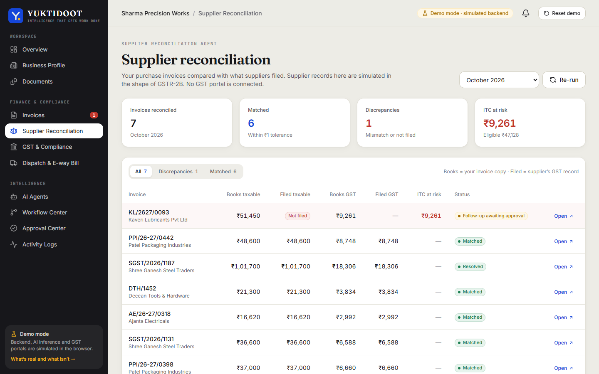 Supplier reconciliation | 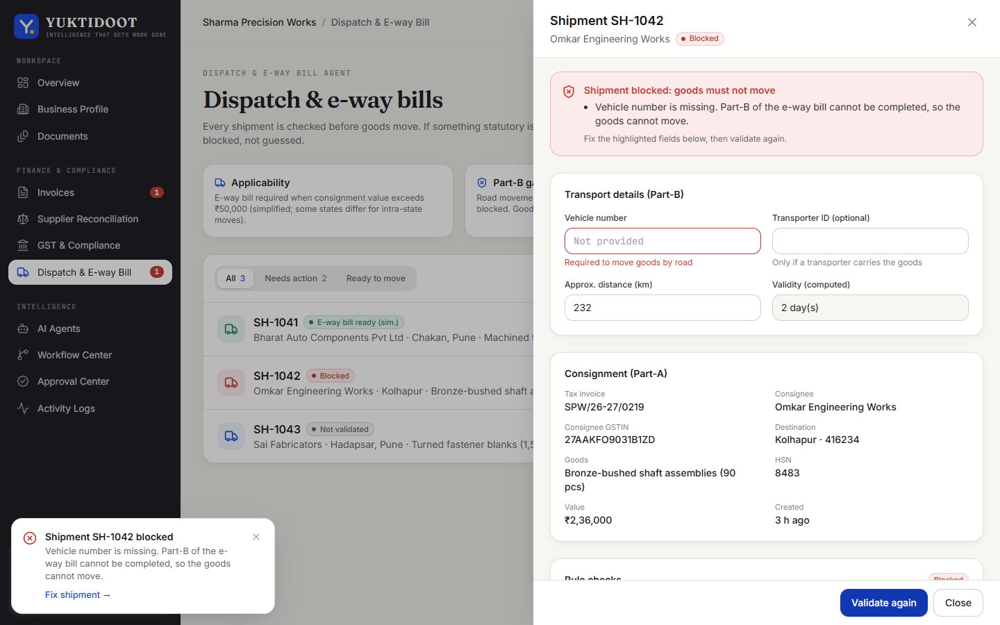 Dispatch blocked: vehicle missing |
| 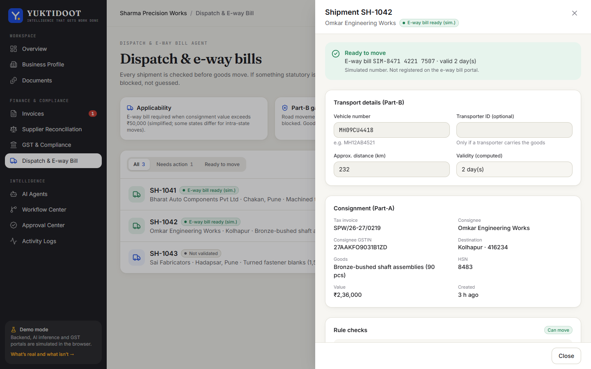 Simulated e-way bill after approval | 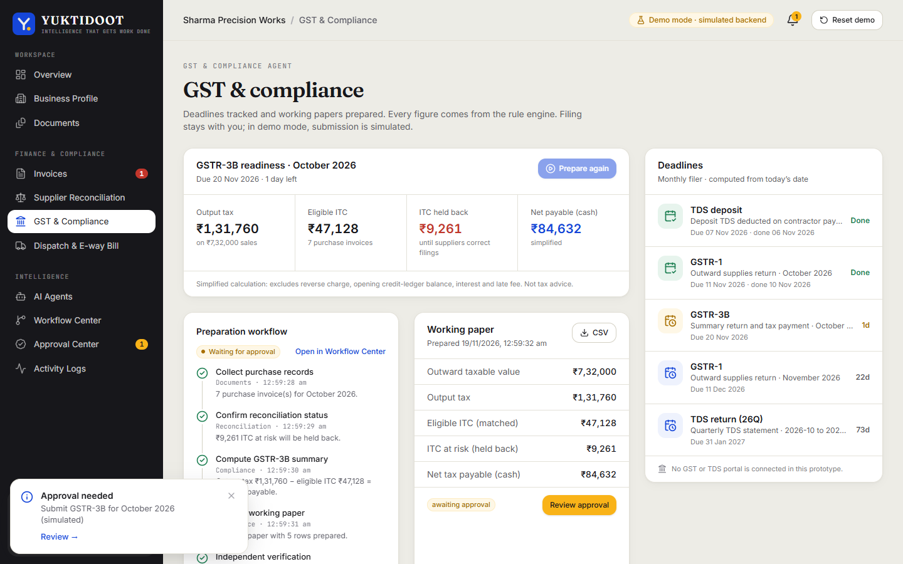 GSTR-3B working paper |
| 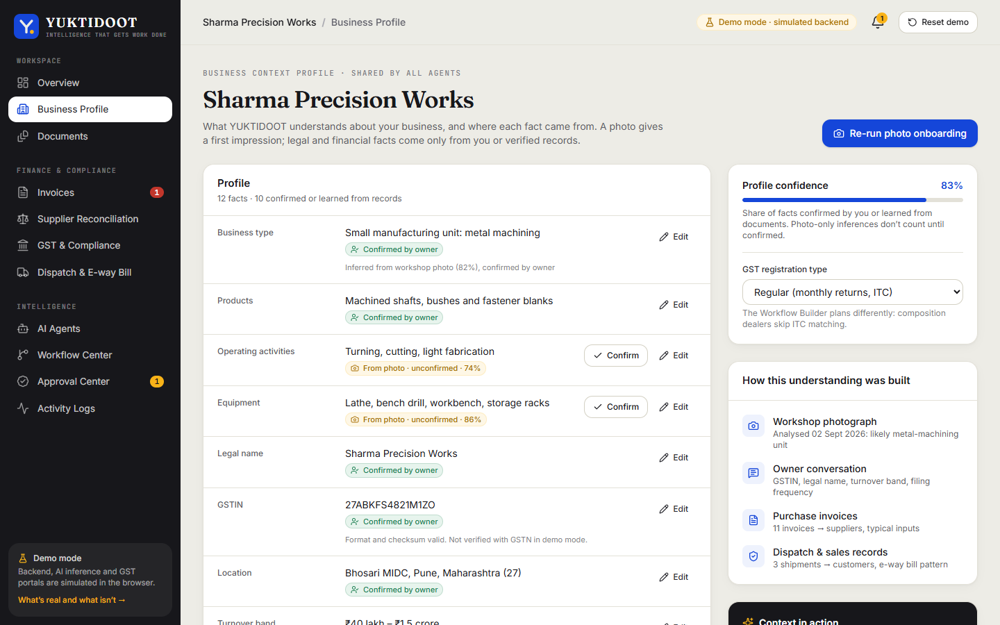 Business Context Profile | 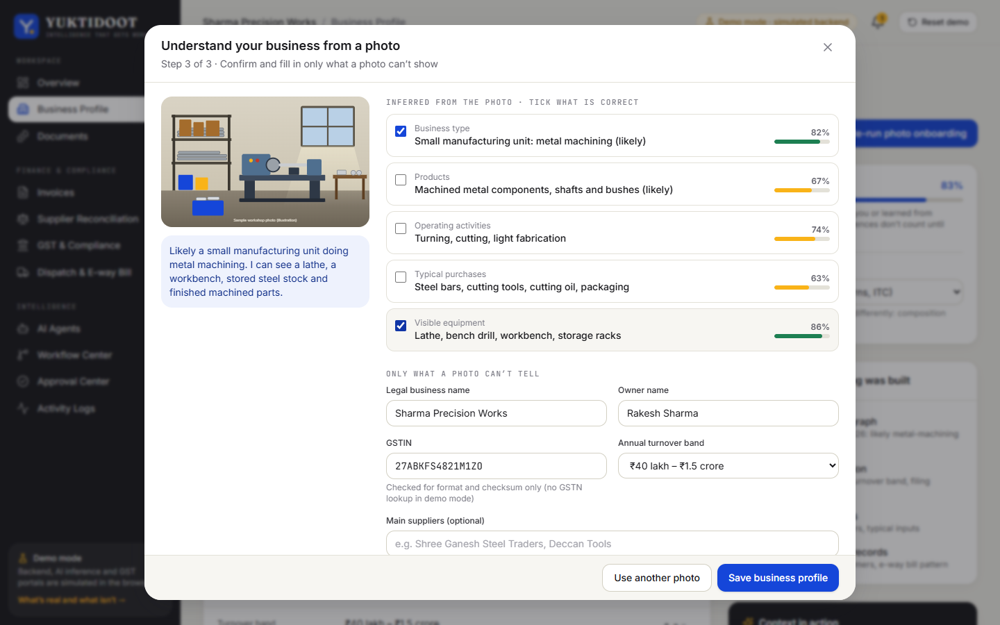 Photo onboarding review |
| 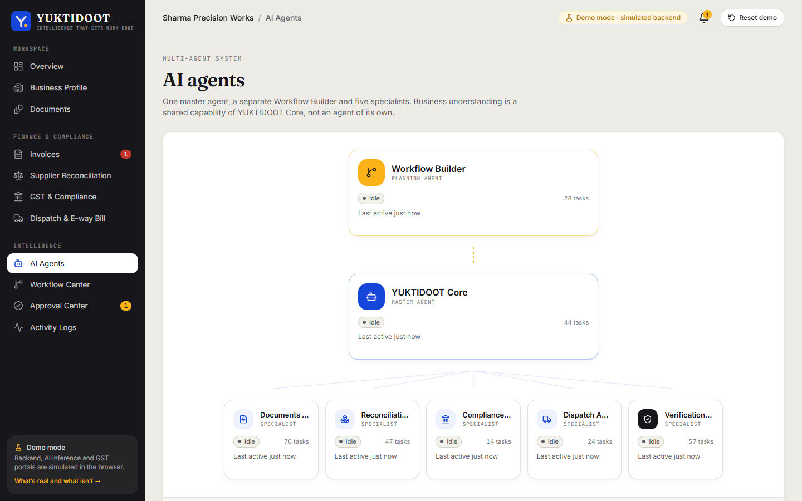 Agents | 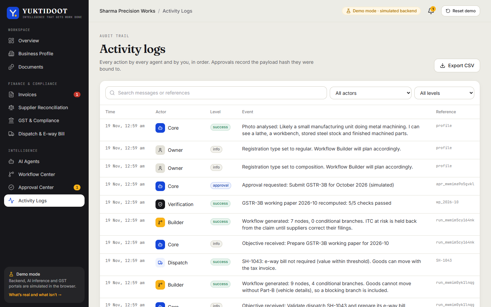 Activity log |
| 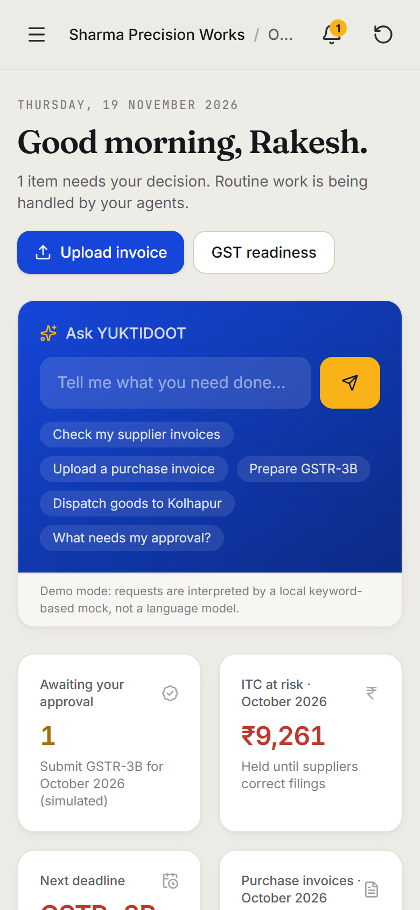 Mobile overview | 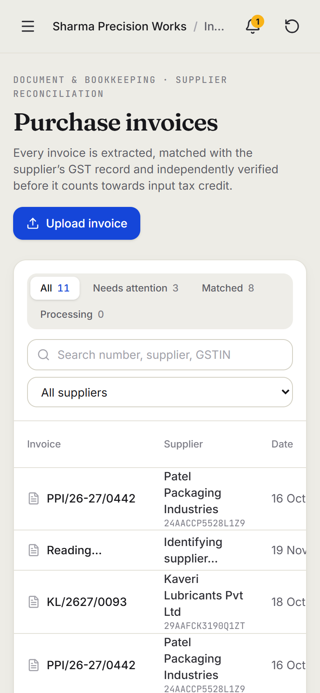 Mobile invoices |

## Roadmap: backend and AI integration

The seams are already in place:

| Step | Replace | With |
|---|---|---|
| 1 | `store/actions.ts` bodies | Calls to a **FastAPI** backend returning the shapes in `types/index.ts` |
| 2 | `localStorage` persistence | **Firestore / Cloud SQL**; documents in **Cloud Storage**; auth via **Firebase Authentication** |
| 3 | `engine/engine.ts` | **Google ADK** orchestration on **Cloud Run**: Core, Workflow Builder and five specialists as ADK agents; **Pub/Sub** + **Cloud Tasks** for steps and retries; the frontend subscribes to run updates |
| 4 | `MockInferenceProvider` | A provider routed through the **0G Private Computer** private inference gateway for photo understanding, extraction and intent. Privacy guarantees depend on the verified 0G configuration and must be confirmed before production use |
| 5 | Mock `gstRecords` | GSTR-2B through a licensed **GSP** (requires registration and the taxpayer's consent) |
| 6 | `SIM-` e-way bill numbers | **NIC e-way bill API** (requires API credentials) |
| 7 | Client-side hashes | Server-side approval records signed per user; secrets in **Secret Manager**, keys in **Cloud KMS**, audit trail in **Cloud Logging** |

The deterministic `services/` (GST maths, reconciliation, verification, dispatch rules) are written to be ported to the backend unchanged, so numbers never depend on a model.

## Known limitations

- Extraction never reads file contents. Any upload resolves to one of five sample invoices, and the generic fallback creates Ajanta Electricals invoices with no GST record.
- The photo analysis result is the same for every photo; the uploaded image is shown but not analysed.
- Rules are simplified: a single ₹50,000 e-way bill threshold (some states differ for intra-state moves), road transport only, and regular-cargo validity. The GSTR-3B calculation excludes reverse charge, the credit-ledger balance, interest and late fees. **Not tax advice.**
- Data lives in one browser's `localStorage`; there are no users or authentication.
- A run in progress during a page reload is marked failed (by design); start it again.
- *Simulate supplier correction* is a demo helper with no real-world equivalent.
- Approval hashes are computed in the browser, so they prove consistency within the app, not to a third party.
