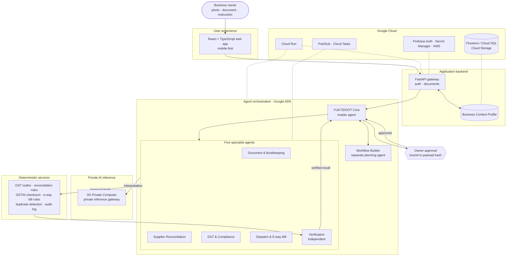
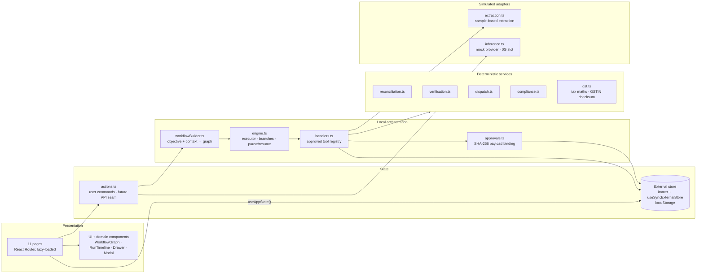
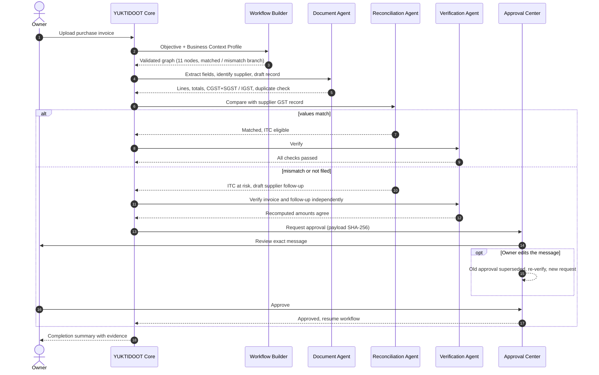
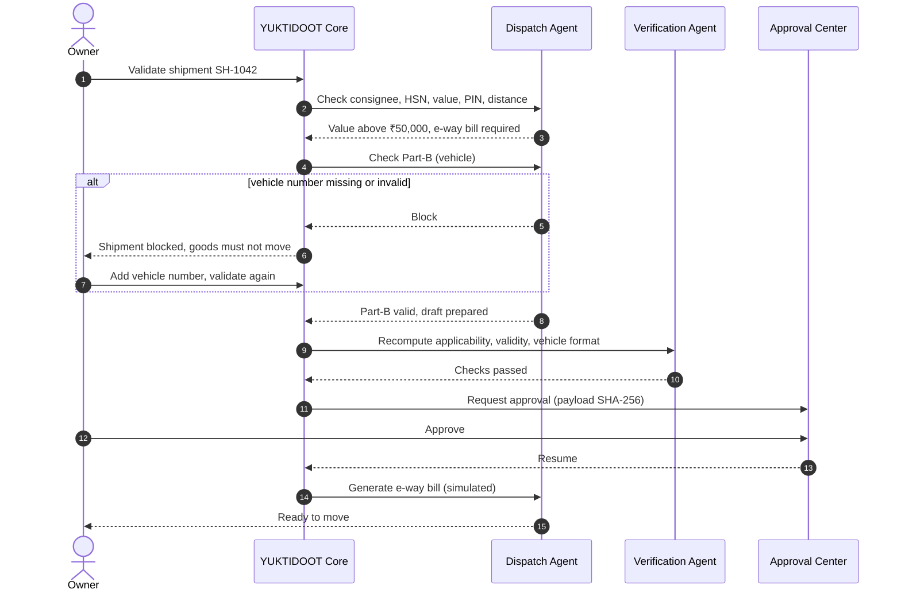
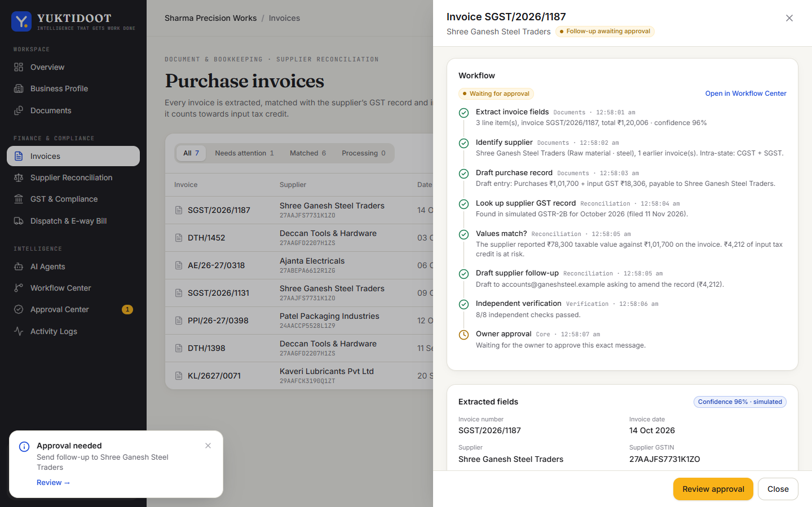
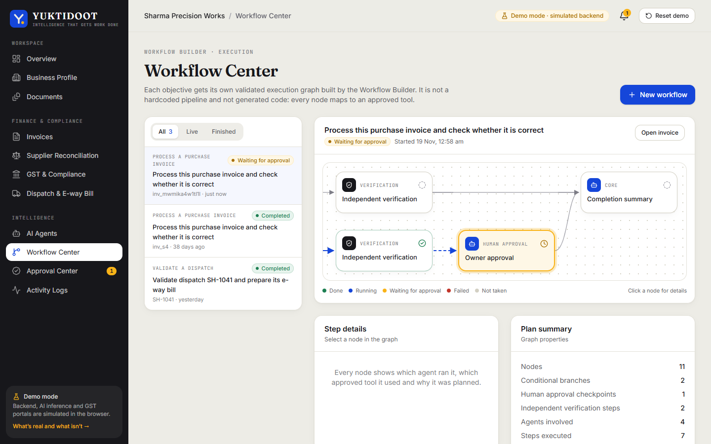
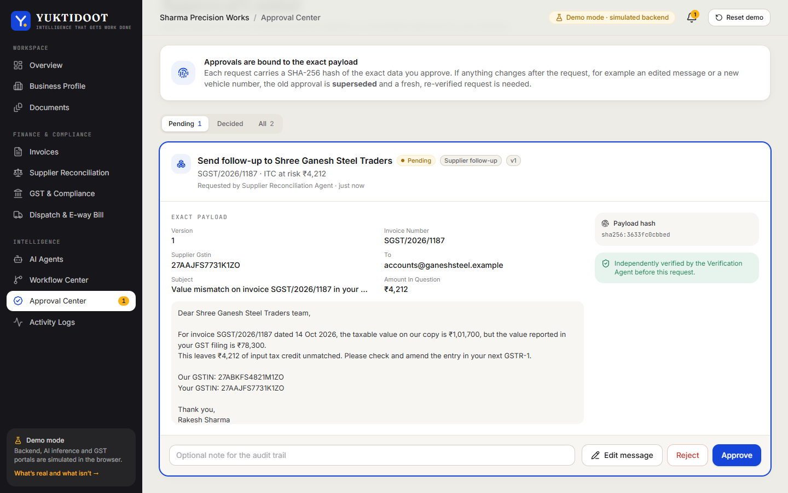

<div align="center">

# YUKTIDOOT

**Intelligence that gets work done.**

An autonomous AI business assistant for Indian micro-enterprises. It understands the business, then prepares, checks and completes routine finance, documentation and compliance work.

`PS 3.1 · MSME Finance & Compliance`


</div>

> **Prototype status:** this repository is the complete, interactive **frontend**. Backend behaviour (agents, extraction, GST data, e-way bills) is simulated in the browser so the full product experience can be evaluated without servers or credentials. See [Prototype scope](#prototype-scope).

---

## Project overview

Micro-enterprises lose time and profit to compliance paperwork. A small workshop owner keeps invoices on paper and in WhatsApp, finds out late that a supplier under-reported an invoice (putting input tax credit at risk), tracks GST deadlines from memory, and holds back shipments because the e-way bill is incomplete.

YUKTIDOOT acts as a digital employee for this work:

- **It understands the business first.** The owner uploads a photo of the shop or workshop. YUKTIDOOT builds a **Business Context Profile** and asks only for what a photo cannot show: GSTIN, legal name, turnover and suppliers. Every fact records its source.
- **It plans the work per task.** A dedicated **Workflow Builder** turns each objective into a validated execution graph with branches and approval checkpoints. There is no fixed pipeline.
- **It delegates to specialists.** One master agent coordinates five specialists: Document & Bookkeeping, Supplier Reconciliation, GST & Compliance, Dispatch & E-way Bill, and an **independent Verification Agent**.
- **It keeps numbers deterministic.** AI interprets and coordinates. Tax figures, reconciliation and statutory rules come from rule code, and the Verification Agent recomputes them from source data.
- **It keeps the owner in control.** Anything external, statutory or irreversible waits for approval. Each approval is bound to a SHA-256 hash of the exact payload, so if the data changes, the approval no longer applies.

## Architecture

### Target system architecture



### Frontend architecture (this repository)



### Sequential execution: purchase invoice reconciliation



### Sequential execution: dispatch and e-way bill



## Key features

- **Visual business understanding:** a photo onboarding wizard that shows inferred facts with confidence, owner confirmation, and checksum-validated GSTIN entry.
- **Document intelligence:** multi-file upload with validation, automatic classification, previews, and safe failure on unreadable documents.
- **Purchase invoice workflow:** extraction, supplier identification, duplicate blocking, draft bookkeeping entry, live timeline.
- **Supplier reconciliation:** books vs supplier filing per invoice, ITC at risk per supplier, follow-up tracking, re-run.
- **Workflow Center:** interactive execution graph showing the taken and skipped branches. Each node shows its agent, its approved tool, its result, and why the Builder planned it.
- **Context-aware planning:** switching the business to the composition scheme removes the ITC-matching steps (11 nodes become 5).
- **Independent verification:** recomputes arithmetic, tax type, GSTIN, duplicates, reconciliation, follow-up amounts, e-way bill rules and working-paper rows.
- **Approval Center:** shows the exact payload, its hash and version, and the verification status. Editing the payload supersedes the earlier approval.
- **Dispatch gate:** a missing or invalid vehicle number blocks the shipment. Validity is computed per distance, and the e-way bill is generated after approval.
- **GST & Compliance:** deadlines computed from today, a GSTR-3B working paper with CSV export, and a TDS summary.
- **AI Agents and Activity Logs:** live agent status, an approved tool registry for each agent, and a full audit trail with filters and CSV export.
- **Product quality:** loading, empty and error states; toasts with deep links; an error boundary per page; a responsive layout down to 390 px.

## Tech stack

- **Frontend:** React 19, TypeScript 5.9 (strict), Vite 8
- **Styling:** Tailwind CSS 4, with Inter, Fraunces and JetBrains Mono bundled locally
- **Routing and state:** React Router 7, immer, `useSyncExternalStore`, localStorage persistence
- **Visualisation:** Recharts, a custom SVG workflow graph, lucide-react icons
- **Security primitives:** Web Crypto SHA-256 payload hashing, GSTIN mod-36 checksum
- **Tooling:** puppeteer-core browser walkthrough with screenshot capture
- **Target platform:** Python FastAPI, Google ADK, 0G Private Computer, Google Cloud (Cloud Run, Firestore / Cloud SQL, Cloud Storage, Pub/Sub, Cloud Tasks, Firebase Auth, Secret Manager, Cloud KMS, Cloud Logging)

**Brand palette:** Warm Beige `#EDECE6` · Cobalt Blue `#1546D9` · Sun Yellow `#F9B318` · Dark Charcoal `#17171B`

## Getting started

Requires **Node.js 20.19+ or 22.12+**. No accounts, API keys or internet connection are needed at runtime.

```bash
git clone https://github.com/Danish26-dev/YUKTIDOOT.git
cd YUKTIDOOT
npm ci
npm run dev          # http://localhost:5173
```

```bash
npm run build        # strict type-check + production build
npm run preview      # serve the build on http://localhost:4173
npm run screenshots  # browser walkthrough of both demos (needs preview running + Chrome/Edge)
```

Optional configuration lives in `.env.example`. The only setting is `VITE_INFERENCE_PROVIDER`, and only `mock` is implemented.

## Demo walkthrough

The app opens with data for *Sharma Precision Works*, a machining unit in Pune. **Reset demo** (top right) restores the starting state.

**1. Purchase invoice reconciliation (about 2 minutes)**
1. Go to **Invoices → Upload invoice** and choose **Shree Ganesh Steel**.
2. Watch the workflow:
   - Extraction finds a taxable value of ₹1,01,700.
   - The supplier filed only ₹78,300, so ₹4,212 of ITC is at risk.
   - A follow-up is drafted, and verification passes 8/8 checks.
3. Open **Approval Center** to see the exact message and its SHA-256 hash. Try **Edit message**: the old approval becomes *superseded* and a re-verified v2 request appears.
4. Click **Approve**. The workflow completes. *Simulate supplier correction* then resolves the invoice.
5. Open **Workflow Center** to see the graph with the taken path and the skipped matched branch.

**2. Dispatch with a missing vehicle number (about 1 minute)**
1. Go to **Dispatch & E-way Bill → SH-1042 → Validate**. The shipment is **blocked** because Part-B has no vehicle number, and no approval is requested.
2. Enter `MH09CU4417` and click **Save & validate**. The checks pass, a draft is prepared, and approval is requested.
3. **Approve** it. A simulated e-way bill is generated and the goods are ready to move.

Also try the other invoice samples (*Patel*: matched; *Kaveri*: not filed; *Blurry photo*: fails safely), **Business Profile → Re-run photo onboarding**, and **GST & Compliance → Prepare working paper**.

## Screenshots

<table>
  <tr>
    <td><br/><sub>Invoice workflow paused for approval</sub></td>
    <td><br/><sub>Workflow Builder execution graph</sub></td>
  </tr>
  <tr>
    <td><br/><sub>Payload-bound approval</sub></td>
    <td><br/><sub>Dispatch blocked: vehicle number missing</sub></td>
  </tr>
  <tr>
    <td><br/><sub>Business understanding from a photo</sub></td>
    <td><br/><sub>Master agent, Workflow Builder, five specialists</sub></td>
  </tr>
</table>

## Project structure

```
src/
├── pages/        11 screens (Overview, Profile, Documents, Invoices, Reconciliation,
│                 Compliance, Dispatch, Agents, Workflows, Approvals, Activity)
├── components/   ui/ primitives · domain/ workflow graph, timelines, invoice views · layout/
├── engine/       workflow executor, approved tool registry, payload-bound approvals
├── services/     workflow builder, reconciliation, verification, dispatch, compliance,
│                 extraction (simulated), inference provider (mock)
├── store/        external store, user actions, seed data, toasts
├── data/         sample invoices, suppliers, agent catalogue
├── lib/          GST maths, GSTIN checksum, hashing, formatting
└── types/        domain model (the contract for the future backend)
```

## Prototype scope

To keep this evaluation transparent, here is what the prototype does and does not include.

- **Runs in the browser:** every screen and interaction, the Workflow Builder and executor, the reconciliation and dispatch rule engines, GST arithmetic, independent verification, SHA-256 payload-bound approvals, CSV exports and local persistence.
- **Simulated:**
  - Document extraction maps each upload to a sample invoice; file contents are not read.
  - Photo analysis and "Ask YUKTIDOOT" use a local mock provider.
  - Supplier GST records are mock data shaped like GSTR-2B.
  - E-way bill numbers (`SIM-…`) and GSTR-3B submission are simulated.
  - Follow-ups open the email app; nothing is sent automatically.
- **Not connected yet:** the FastAPI backend, Google ADK, 0G Private Computer, Google Cloud services, and GSP or e-way bill portal APIs.
- **Rules are simplified:** a single ₹50,000 e-way bill threshold; GSTR-3B excludes reverse charge, credit-ledger balance, interest and late fees. Not tax advice.

Verified locally: a strict type-check and production build with 0 errors, and a browser walkthrough of both demos with **30/30 checks passing**.

## Roadmap

1. **Backend:** replace `store/actions.ts` with FastAPI calls returning the types in `src/types`, and persist to Firestore / Cloud SQL and Cloud Storage.
2. **Agents:** move Core, Workflow Builder and the five specialists to Google ADK on Cloud Run, with Pub/Sub and Cloud Tasks driving steps and retries.
3. **Private inference:** connect photo understanding, extraction and intent interpretation to the 0G Private Computer gateway through the existing `InferenceProvider` interface.
4. **Integrations:** add GSTR-2B and filing through a licensed GSP, and the NIC e-way bill API.
5. **Trust:** sign approval records server-side per user, use Secret Manager and Cloud KMS, and keep the audit trail in Cloud Logging.

The deterministic services in `src/services` are designed to move to the backend unchanged, so tax figures never depend on a model.
